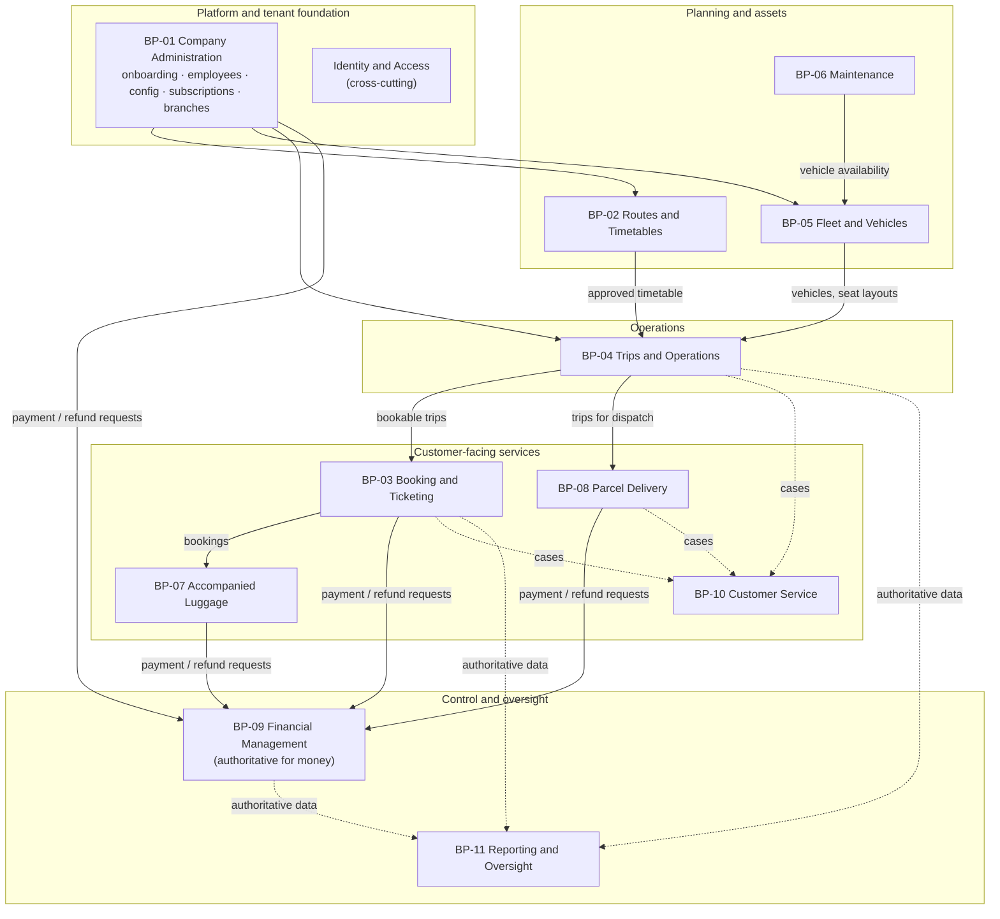

# 01 — System Overview

**Status:** Proposed, v0.1. See [README](README.md) for sources and conventions.

## 1. What TransitHub is

TransitHub is a **multi-company transport management platform**. A platform operator onboards independent transport companies. Each company then uses TransitHub to run its business: its people, routes and timetables, vehicles and maintenance, daily trips, passenger tickets, luggage, parcels, money, customer complaints and management reporting.

It is **not** just a ticket-booking website. Ticket sales are one of eleven business processes.

Three kinds of party use the platform:

| Party | Examples | What they get |
|---|---|---|
| **Platform operator** | Platform administrators, registration and verification officers, approvers, commercial and support staff | Onboard and oversee companies, sell and manage subscriptions, provide support |
| **Transport companies (tenants)** | Company administrators, HR, operations officers, drivers, fleet and maintenance staff, ticketing and parcel clerks, finance, customer service, managers | One system to run their whole operation, with their data strictly isolated from other companies |
| **The public** | Passengers, parcel senders and recipients | Search and book trips, buy tickets, send and track parcels, raise complaints |

### How the platform earns money [Approved basis]
- **Recurring subscriptions** paid by transport companies (BP-01.04).
- **Commission on successful marketplace ticket purchases**, that is, tickets sold through TransitHub's online channel.
- **No automatic commission** on tickets sold at a company's physical ticket office.

The commission calculation, rates, exceptions and settlement still need specification (BP-09 with BP-03).

## 2. Core principles that shape everything [Approved basis]

1. **Strict tenant isolation.** One company can never see or change another company's data unless there is an explicitly authorised business purpose. This is enforced in the backend and database, not only in the user interface.
2. **Each business process owns its records.** Other processes may read them through defined interfaces but never overwrite them.
3. **Companies operate differently.** Policies such as luggage allowances, fares and grace periods are configurable per company rather than hard-coded.
4. **Nothing important is silently changed or lost.** Important actions are audited, history is preserved, and corrections create new records instead of overwriting old ones.
5. **Money is controlled.** Separation of duties, approvals for refunds and adjustments, and idempotent (duplicate-safe) financial operations.
6. **Job titles do not grant permissions.** Who a person is (employee), what they are responsible for (position) and what they may do in the system (permissions) are kept separate.
7. **Field work must survive poor connectivity.** Company registration in the field must work offline and synchronise later without creating duplicates.
8. **Timetables drive operations.** Trips are created from the approved timetable, not ad hoc.

## 3. The major parts of the system

TransitHub is organised into **11 business processes** (117 subprocesses), plus shared platform capabilities.

### BP-01 Company Administration
**What it does:** It brings transport companies onto the platform and manages them as tenants.

| Subprocess | Purpose |
|---|---|
| BP-01.01 Company Onboarding and Verification | Field officers register a company (offline-capable) with evidence and representative acknowledgement. Officers verify it, request more information where needed, and an approver gives a final decision. A rejection can be appealed and independently reviewed. **A permanent Company record with an auto-generated company code is created only after approval.** It also covers continuity: delegation, reassignment, escalation and corrective actions for onboarding work. |
| BP-01.02 Employee Administration | Company employee records (separate from login accounts), the employment lifecycle, organisation structure, positions and acting appointments, leave, attendance, eligibility (licences, training), substitution, offboarding and self-service. Company-specific employee IDs. |
| BP-01.03 Company Configuration Management | Company policies and settings, plus controlled, validated export and import of configuration (for example to new branches) without bypassing tenant isolation or platform rules. |
| BP-01.04 Subscription Management | What companies pay the platform: plans, entitlements, activation, renewal, grace periods, changes, cancellation and reactivation, refunds, disputes, promotions, referrals, commercial agreements and e-signing. |
| BP-01.05 Branch Management | The company's branches, depots and offices. |
| BP-01.06 Company Operational Status | Whether a company is active, suspended or deactivated, and what it may do in each state. |
| BP-01.07 Platform Support | Support requests from companies to the platform operator, and the knowledge base. |
| BP-01.08 Company Reporting and Oversight | Platform-level oversight of companies. |
| BP-01.09 Company Ownership Transfer | Controlled transfer of a company to new owners. |

### BP-02 Route and Timetable Management
**What it does:** It defines *where* and *when* the company plans to operate: stops and terminals, routes (ordered stops), and timetables that go through approval and publication. Timetables are versioned so history is kept. **The approved timetable is the authority for creating trips.**

### BP-03 Passenger Booking and Ticketing
**What it does:** It sells seats through two kinds of channel, the online marketplace and physical sales (company offices and authorised agents), which share **one** authoritative seat availability [Approved basis]. It has ten subprocesses [Approved basis: working structure]:

| Subprocess | Purpose |
|---|---|
| BP-03.01 Passenger Account Management | Passenger registration, sign-in, profiles and account security. **Separate from employee accounts** |
| BP-03.02 Journey Search and Availability | Search, journey information, availability and fares, consistent across channels |
| BP-03.03 Seat Selection and Reservation | Seat choice and reservation. **A reservation is not a purchase** |
| BP-03.04 Online Ticket Sales | Online purchase. **Paid only once payment is confirmed** |
| BP-03.05 Physical Ticket Sales | Sales at company offices and by authorised agents, always through TransitHub |
| BP-03.06 Ticket Issuance and Validation | Tickets issued only after confirmation, traceable to booking and sale |
| BP-03.07 Booking Modification and Cancellation | Under the company's own policies, without erasing history |
| BP-03.08 Ticket Refund Management | The refund **workflow**. BP-09 approves and settles the money |
| BP-03.09 Ticket Sales Reconciliation | Matching sales records against financial records |
| BP-03.10 Ticket Sales Reporting | Sales performance and channel reporting |

Rules: [../requirements/bp-03-passenger-booking-register.md](../requirements/bp-03-passenger-booking-register.md).

### BP-04 Trip and Operations Management
**What it does:** It runs the actual journeys. Operations officers create trips from the approved timetable and assign a vehicle and crew. They check readiness, board passengers against the manifest, record departures, stops and arrivals, handle incidents, delays and cancellations, and close completed trips. **BP-04 owns actual trip assignments of vehicles and people.**

### BP-05 Fleet and Vehicle Management
**What it does:** It maintains the vehicle register: classification, configurable seat layouts and facilities, documents (insurance, roadworthiness, permits) with expiry tracking, status, branch allocation and availability.

### BP-06 Maintenance Management
**What it does:** It keeps vehicles safe and available through preventive schedules, defect reports, inspections, work orders, parts used, return-to-service approval and maintenance history.

### BP-07 Accompanied Passenger Luggage
**What it does:** It handles luggage that travels with a booked passenger: registration against the booking, configurable allowances, excess-luggage charges, tagging, loading and handover, and lost or damaged luggage. **It is separate from parcels.**

### BP-08 Unaccompanied Parcel Delivery
**What it does:** It is a courier service on the company's trips. Staff accept a parcel with sender and recipient details, classify it, calculate the tariff, take payment, dispatch it on a trip, track it, notify the recipient and confirm delivery. It also handles failed deliveries, returns, claims and settlement.

### BP-09 Financial Management
**What it does:** It is the **single source of truth for money**: payments (including gateway integration), refunds, adjustments, ledger and accounting records, cash-up and reconciliation, and settlements. Other modules *request* financial actions and receive outcomes. They never record money themselves.

### BP-10 Customer Service Management
**What it does:** It handles formal customer cases and complaints, from logging and assignment through investigation, escalation and resolution to customer communication and case history.

### BP-11 Reporting and Management Oversight
**What it does:** It provides operational and financial reports, dashboards, KPIs and exception reports at company and platform level. It also records management findings and tracks corrective actions. Financial figures must reconcile with BP-09.

### Cross-cutting capabilities
| Capability | Purpose |
|---|---|
| Identity and Access | User accounts, authentication, roles and permissions scoped to company and branch, and delegated authority |
| Audit | Immutable record of who did what, when and why |
| Notifications | Messages to staff, passengers, senders and recipients |
| Documents and evidence | Secure storage of uploaded files |
| Governance and continuity | Nine reusable mechanisms (G1–G9): assignment and acceptance, delegation, emergency appointments, notification and acknowledgement, independent review, corrective actions, escalation and management review, suitability review, and incident / risk / alert registers. They cover BR-ONB-111–274 once, for every module; see [04-business-rules-analysis.md](04-business-rules-analysis.md) |
| Offline sync | Capture in the field and synchronise idempotently |

## 4. How the parts work together (key end-to-end flows) [Proposed]

1. **Onboard a company:** BP-01.01 registration is verified and then approved. BP-01.01 creates the Company with a generated code. Identity and Access creates the first company administrator account. BP-01.04 activates a subscription. BP-01.06 marks the company operationally ready.
2. **Prepare to operate:** BP-01.05 sets up branches and BP-01.02 adds employees. BP-05 registers vehicles and seat layouts. BP-02 publishes approved routes and timetables.
3. **Run a day of service:** BP-04 generates trips from the timetable and assigns vehicles (checked against BP-05 and BP-06 availability) and crew (checked against BP-01.02 eligibility). BP-03 sells seats on those trips, and BP-09 records the payments. BP-07 registers luggage. BP-08 assigns parcels to the trip. BP-04 boards, departs, arrives and closes the trip.
4. **Something goes wrong:**
   - A vehicle defect raises a BP-06 work order. BP-05 marks the vehicle unavailable, and BP-04 reassigns the trip.
   - When a trip is cancelled, BP-04 publishes an event. BP-03 handles the affected bookings, BP-09 refunds, and BP-10 handles the complaints.
5. **Oversee:** BP-11 reports on operations and finance using authoritative data from each owner, and tracks findings and corrective actions.

## 5. Open questions for this overview [Open]

1. **Who owns fares?** Fares might be part of the BP-02 route definition, a BP-03 pricing policy or a BP-09 tariff. Luggage (BP-07) and parcel (BP-08) tariffs are stated as owned by their modules.
2. ~~Is there a public passenger channel?~~ **Answered:** yes, a ticket marketplace (it earns commission). **Still open:** is it in the first release?
3. ~~Do passengers have accounts?~~ **Answered:** yes, passenger accounts exist and are managed by BP-03.01, separately from employee accounts. **Still open:** can a passenger also book *without* an account (guest booking)?
4. **Does BP-01.08 (Company Reporting and Oversight) overlap with BP-11?** Where is the boundary?
5. ~~Who boards passengers?~~ **Answered:** BP-03 owns ticket validation (BP-03.06), and BP-04 owns the manifest, boarding and journey execution. **Still open:** the detailed boarding-validation, reuse-prevention and offline rules.
