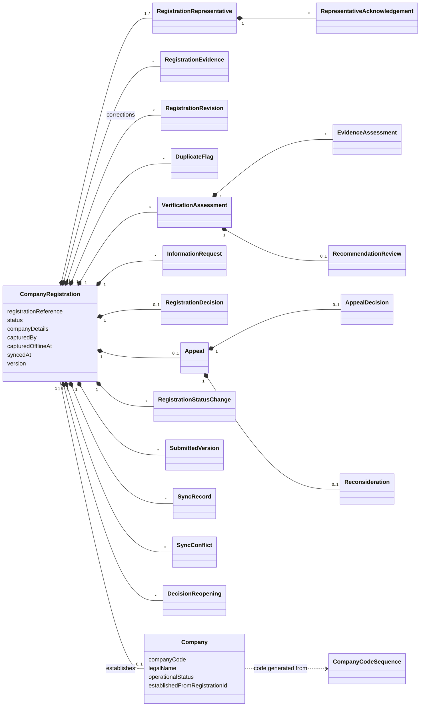
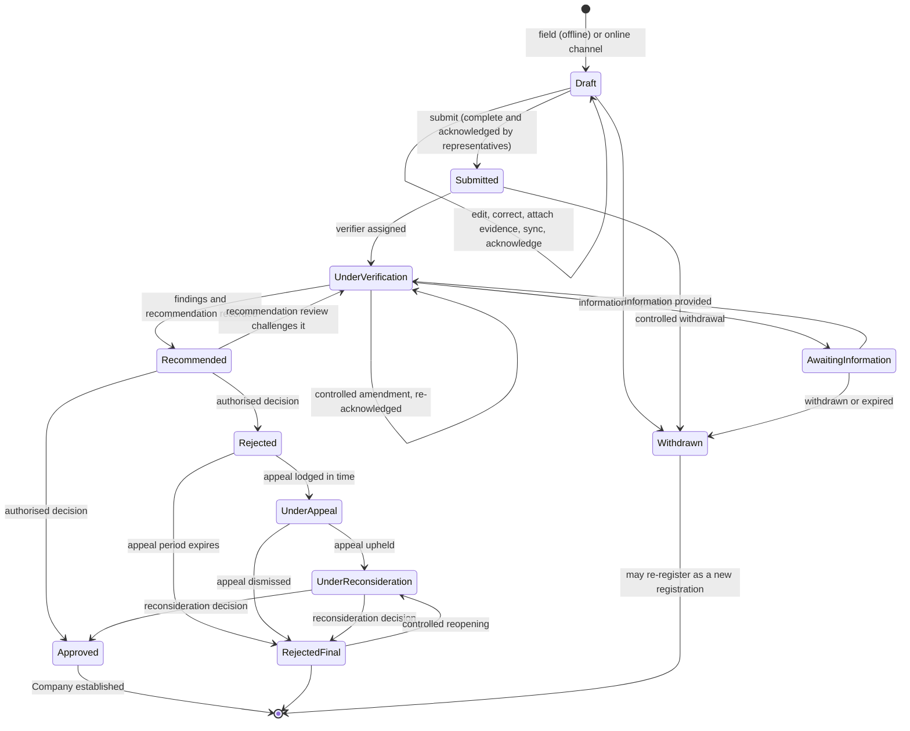
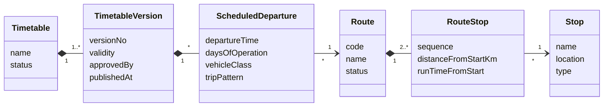
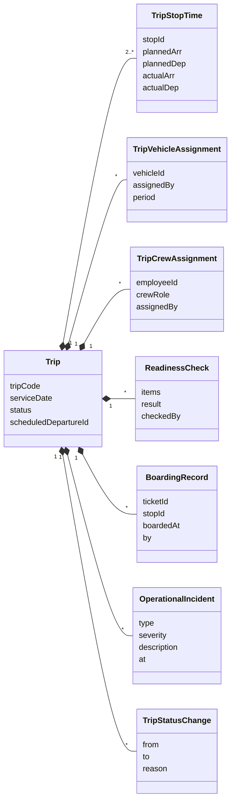
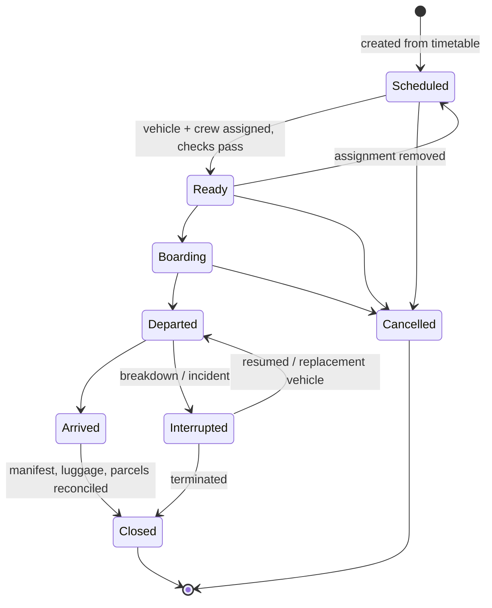
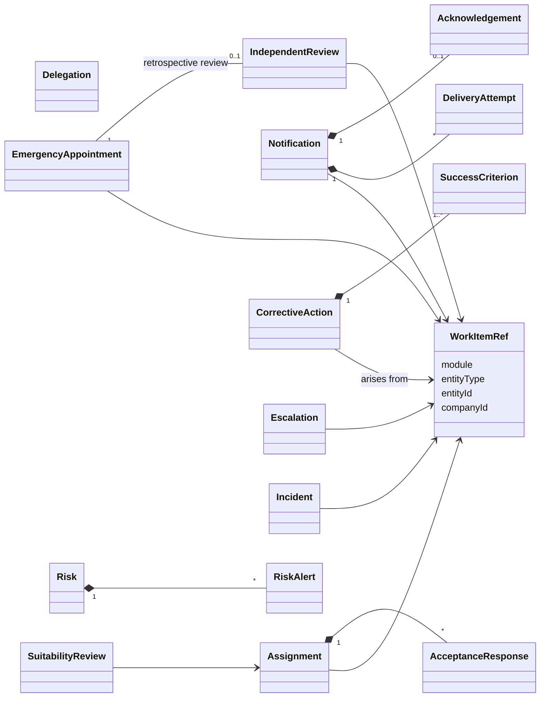

# 03 — Domain Model

**Status:** Proposed, v0.1. See [README](README.md) for sources and conventions.

This is a **conceptual / logical** domain model: the business things TransitHub manages, their key information, relationships, owners and lifecycles. It is **not** the physical database design. Column types, indexes and table splits come later in the design phase.

The BP-01.04 Subscription model here is high-level only. Your approved logical models for promotional campaigns (Promotional Code, Redemption Record, Discount Application and so on) **supersede** it where they overlap.

---

## 1. Modelling rules [Proposed]

1. **One owner per entity.** Each entity belongs to exactly one module (business process). Only that module creates or changes it.
2. **Cross-module references are by identifier only.** For example, a Booking holds a `tripId`; it does not embed or modify the Trip. Reading another module's data goes through that module's interface.
3. **Aggregates.** Each module's main entity is an *aggregate root* (marked ◆ below). Its child entities are changed only through the root, which keeps its business rules consistent in one place.
4. **Every tenant-owned entity carries `companyId`.** This is the basis for tenant isolation. Platform-owned entities (plans, platform staff, registrations before approval) do not.
5. **History, not overwrite.** Lifecycle changes are recorded as status history. Corrections create new versions. Approvals are recorded as decision entities with who, when and why.
6. **Money is a value object:** `Money(amount, currency)`. Modules hold *references* to BP-09 financial transactions, never their own payment truth.

### Shared value objects
| Value object | Contents |
|---|---|
| Money | amount, currency |
| ContactDetails | phone, email, postal / physical address |
| PersonName | given names, surname |
| IdentityDocument | type, number, issuing country, expiry |
| Period | validFrom, validTo |
| GeoLocation | latitude, longitude |
| AuditStamp | createdBy, createdAt, lastChangedBy, lastChangedAt |

---

## 2. Context map: who owns what

| Module | Aggregate roots it owns | References (by id) from other modules |
|---|---|---|
| BP-01.01 Onboarding | ◆ CompanyRegistration, ◆ Company | User (Identity) |
| BP-01.02 Employees | ◆ Employee, ◆ OrganisationUnit, ◆ Position | Company, Branch, UserAccount |
| BP-01.03 Configuration | ◆ CompanyConfiguration | Company |
| BP-01.04 Subscriptions | ◆ SubscriptionPlan, ◆ Subscription, ◆ PromotionalCampaign, ◆ CommercialAgreement | Company, FinancialTransaction |
| BP-01.05 Branches | ◆ Branch | Company |
| BP-01.06 Operational status | (state on Company; see §3.1) | — |
| Identity and Access | ◆ UserAccount, ◆ Role, ◆ Delegation | Company, Branch, Employee |
| BP-02 Routes | ◆ Stop, ◆ Route, ◆ Timetable | Company, Branch |
| BP-05 Fleet | ◆ Vehicle, ◆ SeatLayout | Company, Branch |
| BP-06 Maintenance | ◆ WorkOrder, ◆ MaintenancePlan, ◆ DefectReport | Vehicle, Employee |
| BP-04 Trips | ◆ Trip | ScheduledDeparture, Vehicle, Employee |
| BP-03 Booking | ◆ PassengerAccount, ◆ SeatReservation, ◆ Booking, ◆ TicketRefundRequest | Trip, Seat, FinancialTransaction |
| BP-07 Luggage | ◆ LuggageItem, ◆ LuggagePolicy | Booking, Trip, FinancialTransaction |
| BP-08 Parcels | ◆ Parcel, ◆ ParcelTariff | Trip, Branch, FinancialTransaction |
| BP-09 Finance | ◆ FinancialTransaction, ◆ LedgerAccount, ◆ Reconciliation, ◆ Settlement | Any requesting module (by source reference) |
| BP-10 Customer Service | ◆ ServiceCase | Booking, Parcel, LuggageItem, Trip (by id) |
| BP-11 Reporting | ◆ ManagementFinding, ◆ CorrectiveAction, ReportDefinition | Any (read only) |
| Shared | AuditEvent, OutboxEvent, Notification, StoredDocument | — |

---

## 3. Module models

### 3.1 BP-01.01 Company Onboarding and Verification

| Entity | Key information | Notes |
|---|---|---|
| ◆ CompanyRegistration | registrationReference (unique, generated on device), status, company details (legal name, trading name, registration no., tax no., business type, address, contacts), capturedBy, capture location, captured / synced timestamps, version | Exists **before** a Company [Approved basis]. Not tenant-scoped: the tenant does not exist yet |
| RegistrationRepresentative | name, identity document, capacity / role in company, contacts | **One or more** per registration [Approved basis: BR-ONB-012–020] |
| RepresentativeAcknowledgement | representative, registration version acknowledged, outcome (acknowledged / refused + reason), method (physical / electronic), at | Invalidated by a material change; re-acknowledgement required [Approved basis] |
| SubmittedVersion | version no., full snapshot of submitted data, submittedBy / at | The submitted version is preserved [Approved basis: BR-ONB-043–044] |
| SyncRecord | device id, sync attempt, items, outcome, at | Sync history [Approved basis: BR-ONB-027]. Sync is **not** submission |
| SyncConflict | central version, offline version (both preserved), detectedAt, resolvedBy, resolution, reason | Resolved by an authorised person [Approved basis: BR-ONB-024–026] |
| RegistrationEvidence | evidence type, stored document id, uploadedBy / at, checksum | Files live in StoredDocument |
| RegistrationRevision | revision no., changed fields (before / after), reason, changedBy / at | Corrections never overwrite [Approved basis] |
| DuplicateFlag | matched registration or company id, match reason, score, resolution | |
| VerificationAssessment | verifier, assignedBy, due date, started / completed at, recommendation (approve / reject), findings | Verifier must be independent [Approved basis: BR-ONB-046] |
| RecommendationReview | reviewer, outcome (endorse / challenge), comments, at | Independent review of the recommendation [Approved basis: BR-ONB-062] |
| EvidenceAssessment | evidence id, outcome (accepted / insufficient / invalid), comment | |
| InformationRequest | requested items, requestedBy / at, due date, response, respondedAt | |
| RegistrationDecision | outcome (approved / rejected), reasons, decidedBy / at | Decided by the Approver, not the Verifier [Approved basis] |
| Appeal | grounds, new evidence, lodgedBy / at, assigned reviewer | |
| AppealDecision | outcome (upheld / dismissed), reasoning, decidedBy / at | Reviewer is independent |
| Reconsideration | appeal, independent officer, findings, recommendation, final decision (by authorised decider), at | Follows an upheld appeal; may lead to establishment [Approved basis: BR-ONB-076–087] |
| DecisionReopening | decision reopened, grounds, authorisedBy, independent reviewer, deadline, outcome | Controlled reopening [Approved basis: BR-ONB-088–092] |
| RegistrationStatusChange | from, to, actor, at, reason | Full lifecycle history |
| ◆ Company | id, **companyCode** (auto-generated, unique, immutable), legal and trading names, registration no., contacts, establishedFromRegistrationId, operationalStatus, establishedAt | The **tenant root**. Every tenant-owned entity references its id |
| CompanyCodeSequence | format, next value | Guarantees unique generated codes [Open: format] |

**CompanyRegistration lifecycle** [Proposed; reconciled with the group-level register for BR-ONB-012–092; still to check line by line]

Notes:
- **Synchronisation does not change status.** A synced draft is still a Draft [Approved basis].
- **Approved ≠ operational.** Approval establishes the Company; operational status is a separate lifecycle (below) [Approved basis: BR-ONB-038].
- The exact names of states and where "further challenge" (BR-ONB-085–087) re-enters still need line-by-line checking.

**Company operational status** (BP-01.06) [Proposed]: `PendingActivation → Active ⇄ Suspended → Deactivated`. Operational readiness (subscription active, administrator account active, at least one branch) is checked separately from status.

### 3.2 BP-01.02 Employee Administration

| Entity | Key information | Notes |
|---|---|---|
| ◆ Employee | companyId, **employeeNumber** (unique per company), name, identity document, contacts, date of birth, employment status | **Separate from UserAccount** [Approved basis] |
| Employment | period, employment type (permanent / contract / casual), status (probation, active, suspended, terminated), reason | An employee can have several employment periods |
| ◆ OrganisationUnit | companyId, name, type (department / branch unit), parent unit | Hierarchy |
| ◆ Position | companyId, title, unit, grade | Positions **do not grant permissions** [Approved basis] |
| PositionAssignment | employee, position, period, kind (substantive / acting) | Acting appointments |
| ResponsibilityAssignment | employee, responsibility, period, assignedBy | |
| EmployeeDocument | type, stored document id, expiry | |
| Qualification | type (driving licence class, PSV permit, medical, first aid), number, issued / expiry | Feeds operational eligibility |
| LeaveRecord | type, period, status, approvedBy | |
| AttendanceRecord | date, clock in / out, overtime, approvedBy | |
| TrainingRecord | course, completedOn, expiry, outcome | |
| AssetIssue | asset / credential type, identifier, issued / returned dates | |
| Acknowledgement | communication id, acknowledgedAt | |

**Boundary:** actual trip crew assignments belong to BP-04 (TripCrewAssignment), not here [Approved basis]. BP-01.02 answers "is this person available and eligible?"; BP-04 decides "this person works this trip".

### 3.3 Identity and Access (cross-cutting)

| Entity | Key information | Notes |
|---|---|---|
| ◆ UserAccount | username / email, credential (hashed), status, MFA settings, type (platform / company) | Optionally linked to one Employee. **Passenger accounts are not UserAccounts.** They belong to BP-03 (PassengerAccount, §3.10) [Approved basis] |
| ◆ Role | name, scope type (platform / company), permission set | Technical permissions, not job titles |
| Permission | code (e.g. `registration.approve`) | |
| RoleAssignment | user, role, scope (companyId, optional branchId), period, grantedBy | Tenant boundary enforced here |
| ◆ Delegation | delegator, delegate, permissions delegated, period, reason, approvedBy | Temporary authority |
| SeparationOfDutiesRule | conflicting permissions | e.g. verify vs approve on the same registration |

### 3.4 BP-01.04 Subscription Management (high level)

| Entity | Key information |
|---|---|
| ◆ SubscriptionPlan | name, versions (price, billing cycle, entitlements, validity) |
| PlanEntitlement | feature / limit (e.g. max vehicles, branches, users) |
| ◆ Subscription | companyId, plan version, status, current period, grace period end, auto-renew |
| SubscriptionPeriod | period, amount charged, financialTransactionId (BP-09) |
| SubscriptionChange | from plan → to plan, effective date, proration |
| ◆ PromotionalCampaign | period, limits, approval, discount rule → *see approved FR-SUB-005 model* |
| PromotionalCode / Redemption / DiscountApplication | → *see approved FR-SUB-005 model* (duplicate-safe redemption) |
| Referral / ReferralReward | referrer, referred company, eligibility outcome, reward |
| ◆ CommercialAgreement | versions, approval history, signature records |
| SignatureRecord | signer, provider reference, signedAt |
| SigningRequest | document, required signatories, signing order, authority check, status (Pending / Completed / Rejected / Expired / Cancelled), reissue of |
| ◆ PaymentObligation (invoice) | subscription, period, amount due, due date, status. Invoice content still open (S14 #13) |
| ◆ SubscriptionRefundRequest | original payment, full / partial, amount, reason, preparedBy, approvedBy (≠ preparedBy), BP-09 reference. Does **not** cancel the subscription |
| ◆ PaymentDispute | disputed transaction, assignee, evidence, findings, decision. Never refunds automatically |
| KnowledgeArticle | topic, versions, publishedBy, linked support requests |
| Investigation | scope, period, evidence, findings, control weaknesses, corrective actions (G6), conclusion; auditor read-only access |

Reconciled at decision level with [../requirements/bp-01.04-subscription-payments-register.md](../requirements/bp-01.04-subscription-payments-register.md) (S1–S13). **Subscription status is separate from company operational status** [Approved basis: S2]. Payment confirmation and activation are separate, controlled events [Approved basis: S3].

**Subscription lifecycle** [Proposed]: `Pending → Active → (renewal due) → GracePeriod → Active | Lapsed`; `Active → Cancelled` (at period end); `Cancelled / Lapsed → Active` (reactivate). A refund does **not** cancel a subscription by itself [Approved basis].

### 3.5 BP-01.03 Configuration and BP-01.05 Branches

| Entity | Key information |
|---|---|
| ◆ CompanyConfiguration | companyId, versioned set of policy settings (e.g. booking hold time, cancellation policy, luggage policy reference, parcel tariff reference) |
| ConfigurationPackage | export of a configuration version, checksum, exportedBy, compatibility version |
| ConfigurationImport | package, target (branch / environment), validation results, conflicts, appliedBy |
| ◆ Branch | companyId, code, name, type (terminal / office / depot), address, location, status, period |

### 3.6 BP-02 Route and Timetable Management

| Entity | Key information | Notes |
|---|---|---|
| ◆ Stop | companyId, name, type (terminal / stop), location, branchId (optional) | [Open] are stops shared across companies (e.g. a public bus station)? |
| ◆ Route | companyId, code, name, origin, destination, status | |
| RouteStop | sequence, stop, distance, planned run time, boarding / alighting allowed | |
| ◆ Timetable | companyId, name, route(s) | |
| TimetableVersion | version no., validity period, status (Draft → Submitted → Approved → Published → Superseded / Withdrawn), approvals | Published versions are immutable; changes create a new version |
| ScheduledDeparture | route, departure time, days of operation, required vehicle class | **The template from which BP-04 creates Trips** |
| Fare [Open owner] | route, origin–destination pair, class, amount, validity | |

### 3.7 BP-05 Fleet and Vehicle Management

| Entity | Key information | Notes |
|---|---|---|
| ◆ Vehicle | companyId, fleet number, registration plate, VIN, make / model / year, vehicle class, seatLayoutId, home branch, status | |
| VehicleClass | name (e.g. luxury coach, standard, minibus), facilities | |
| ◆ SeatLayout | companyId, name, decks, rows / columns, seats | Configurable per vehicle type [Approved basis] |
| Seat | seat number, position (deck, row, column), type (window / aisle / accessible / crew), bookable flag | |
| VehicleDocument | type (insurance, roadworthiness, permit), number, issued / expiry, stored document | Expiry drives availability |
| VehicleStatusChange | from, to, reason, at, by | |

**Vehicle status** [Proposed]: `Active ⇄ UnderMaintenance`, `Active ⇄ Unavailable` (expired document, accident), `Active → Retired → Disposed`. Status changes triggered by BP-06 arrive as events; BP-05 applies them.

### 3.8 BP-06 Maintenance Management

| Entity | Key information |
|---|---|
| ◆ MaintenancePlan | vehicle or vehicle class, interval (km / days), tasks, next due |
| ◆ DefectReport | vehicleId, reportedBy, description, severity (safety-critical / minor), tripId (optional), status |
| Inspection | vehicleId, inspector, checklist results, outcome |
| ◆ WorkOrder | vehicleId, source (plan / defect / inspection), tasks, assigned technicians, status (Open → InProgress → Completed → ReturnedToService / Cancelled) |
| WorkOrderTask | description, labour hours, technician, result |
| PartUsage | part, quantity, cost (Money) |
| ReturnToServiceApproval | approvedBy, at, conditions |

A safety-critical defect makes the vehicle unavailable until return-to-service approval [Proposed].

### 3.9 BP-04 Trip and Operations Management

| Entity | Key information | Notes |
|---|---|---|
| ◆ Trip | companyId, tripCode, serviceDate, scheduledDepartureId (+ timetable version), route, status | **Must come from an approved timetable** [Approved basis] |
| TripStopTime | stop, planned and actual times | Seats are sold per origin–destination segment [Open: segment selling?] |
| TripVehicleAssignment | vehicleId, period, reason for change | History kept when a vehicle is replaced |
| TripCrewAssignment | employeeId, crew role (driver / co-driver / conductor), eligibility check result | BP-04 owns this [Approved basis] |
| ReadinessCheck | vehicle available, documents valid, crew eligible, result | |
| BoardingRecord | ticket, stop, time, by whom | Forms the actual manifest |
| OperationalIncident | type (breakdown, accident, delay), severity, description, follow-up (DefectReport / ServiceCase ids) | |

**Trip lifecycle** [Proposed]:

Delay is an attribute (expected vs. planned times), not a separate state.

### 3.10 BP-03 Passenger Booking and Ticketing

Reconciled at decision level with [../requirements/bp-03-passenger-booking-register.md](../requirements/bp-03-passenger-booking-register.md) (A–I).

| Entity | Key information | Notes |
|---|---|---|
| ◆ PassengerAccount | contact (phone, email), credentials / identity-provider reference, profile, security settings, status | **Owned by BP-03.01, never an employee or staff account** [Approved basis: A]. Platform-level, because a passenger can book with many companies |
| ◆ SeatReservation | tripId, seats, origin / destination, channel, expiresAt, status (Active → Converted / Expired / Released) | **A reservation is not a purchase** [Approved basis: C]. Expiry rules [Open: discovery 1–2] |
| ◆ Booking | companyId, bookingReference, passengerAccountId (optional), contact, tripId, origin / destination stops, status, total (Money), **salesChannel**, soldBy (agent, for physical sales), idempotency key | Channel retained on every sale [Approved basis: E, I] |
| BookedPassenger | name, identity document (if required), passenger type (adult / child), seatId | When ID is checked [Open: discovery 9] |
| Ticket | ticket number, booking, passenger, seat, issuedAt, status (Valid / Used / Void), validation code | Issued only after confirmation; traceable to booking and sale [Approved basis: D, F] |
| PaymentReference | financialTransactionId (BP-09), status as reported by BP-09 | BP-03 never decides that money was received [Approved basis: D] |
| BookingModification | change type, before / after, policy version applied, fee, by, at | Under the company's policy; history kept [Approved basis: G] |
| Cancellation | reason, policy version applied, by, at | Distinct from refund [Approved basis: G, H] |
| ◆ TicketRefundRequest | booking, ticket(s), reason, eligibility outcome, requested amount, status, BP-09 refund reference | BP-03 workflow; BP-09 approves and settles [Approved basis: H]. Eligibility [Open: discovery 6–7] |
| SalesChannel (value) | MARKETPLACE_ONLINE / COMPANY_OFFICE / AUTHORISED_AGENT | Drives commission eligibility [Approved basis: §4] |

**Seat availability is one authoritative source for every channel** [Approved basis: B, C]. There is no per-channel stock, and the database enforces it (engineering R-20).

**Reservation and booking lifecycles** [Proposed; reservation vs purchase is Approved basis]:
- SeatReservation: `Active → Converted (to a paid booking) | Expired | Released`.
- Booking: `PendingPayment → Confirmed (paid, tickets issued) → Completed | NoShow`; `PendingPayment → Abandoned` (payment failed or uncertain, see discovery 3); `Confirmed → Modified (new version) | Cancelled`. A cancelled booking may raise a TicketRefundRequest.
- A trip change or cancellation in BP-04 triggers UC-03-14 for every affected booking.

### 3.11 BP-07 Accompanied Passenger Luggage

| Entity | Key information |
|---|---|
| ◆ LuggagePolicy | companyId, allowance per passenger type / class (pieces, weight), excess tariff, prohibited items, validity (from configuration) |
| ◆ LuggageItem | bookingId, passenger, tripId, tag number, weight, dimensions, declared contents / value, status (Registered → Loaded → InTransit → HandedBack / Lost / Damaged / Unclaimed) |
| ExcessCharge | items, chargeable weight, amount (Money), financialTransactionId |
| HandoverEvent | from → to (handler / crew / passenger), stop, at, condition |
| LuggageIncident | type (lost / damaged / unclaimed), description, serviceCaseId |

**Always tied to a booked passenger.** Luggage without a travelling passenger is a parcel (BP-08) [Approved basis].

### 3.12 BP-08 Unaccompanied Parcel Delivery

| Entity | Key information |
|---|---|
| ◆ ParcelTariff | companyId, basis (weight / size / distance / class), rates, validity |
| ◆ Parcel | companyId, tracking number, sender, recipient, origin / destination branch, classification (document / small / large / fragile / perishable / high value), weight, declared value, charge (Money), payment mode, status |
| Sender / Recipient | name, contacts, identity document (for collection) |
| DispatchAssignment | tripId, loadedAt, loadedBy, unloadedAt |
| TrackingEvent | status, location / branch, at, by |
| DeliveryAttempt | at, outcome, reason for failure |
| ProofOfDelivery | receivedBy, identity check, signature / OTP, at |
| ParcelClaim | type, claimed amount, outcome, serviceCaseId |

**Parcel lifecycle** [Proposed]: `Accepted → AwaitingDispatch → InTransit → ArrivedAtBranch → ReadyForCollection → Delivered`; `ReadyForCollection → DeliveryFailed → Returned / Disposed (after retention)`; any state `→ Lost / Damaged → Claimed`.

### 3.13 BP-09 Financial Management

| Entity | Key information | Notes |
|---|---|---|
| ◆ FinancialTransaction | companyId (or platform), type (payment / refund / adjustment / settlement), amount (Money), status (Requested → Pending → Succeeded / Failed / Reversed), **sourceModule + sourceReference**, **idempotencyKey**, gateway reference | The only record of money [Approved basis] |
| PaymentMethod / GatewayAttempt | provider, method (cash / mobile money / card), attempt results | |
| RefundApproval / AdjustmentApproval | requestedBy, approvedBy (≠ requester), reason, at | Separation of duties [Approved basis] |
| ◆ LedgerAccount | chart-of-accounts code, type | |
| LedgerEntry | transaction, account, debit / credit, amount | Double-entry [Proposed] |
| CashSession | cashier, branch, opened / closed, expected vs. counted | Till cash-up |
| ◆ Reconciliation | source (gateway / bank / cash), period, matched / unmatched items, status | |
| ◆ Settlement | counterparty, period, amount, status |
| CommissionEntry | booking (marketplace channel only), agreement and rate used (snapshot), amount, reversal of | Commission accounting is BP-09 [Approved basis: BP-03 register §3–4]. Rates and refund treatment [Open] |
| ReconciliationDifference | type (missing / unmatched / duplicate / wrong amount), assignee, evidence, decision | [Approved basis: BP-01.04 S4] | |
| FinancialPeriod | period, status (open / closed) | |

### 3.14 BP-10 Customer Service Management

| Entity | Key information |
|---|---|
| ◆ ServiceCase | companyId, case number, type (complaint / enquiry / claim / compliment), channel, customer, subject reference (bookingId / parcelId / luggageItemId / tripId), priority, SLA due, status (Open → Assigned → UnderInvestigation → Resolved → Closed; Reopened) |
| CaseAssignment | agent, assignedBy, at |
| CaseNote | text, internal / external, by, at |
| Escalation | level, reason, to whom, at |
| Resolution | outcome, compensation request (→ BP-09), agreedBy |
| CustomerCommunication | channel, message, sent / received at |
| Feedback | rating, comment |

### 3.15 BP-11 Reporting and Management Oversight

| Entity | Key information |
|---|---|
| ReportDefinition | name, scope (company / platform), parameters, data sources |
| KpiDefinition | name, formula, target, owner module |
| ◆ ManagementFinding | scope, description, severity, raisedBy, source (report / review / incident) |
| ◆ CorrectiveAction | → the G6 governance entity (§3.16), not a separate copy |

BP-11 **reads** authoritative data and never changes another module's records. Financial figures must reconcile with BP-09 [Approved basis].

### 3.16 Cross-cutting: governance mechanisms (G1–G9)

These implement BR-ONB-111–274 **once**, for every module. See [04-business-rules-analysis.md](04-business-rules-analysis.md) §3.

The central idea is a **WorkItemRef**, `(module, entityType, entityId, companyId)`. It lets any mechanism attach to any business record: a registration, a corrective action, a risk alert, a work order or a complaint. A corrective action about a review about an appointment is just a chain of WorkItemRefs, so no new entity types are needed for each nesting level.

| Mech. | Entity | Key information |
|---|---|---|
| G1 | Assignment | work item, assignee, assignedBy, reason, acceptance deadline, status (Offered → Accepted / PartiallyAccepted / Refused / Expired → Escalated), supersedes (reassignment chain) |
| G1 | AcceptanceResponse | response type, accepted scope (for partial), refusal reason, at |
| G2 | Delegation | delegator, delegate, authority, period, extensions, revokedAt / by, reason (also in Identity and Access) |
| G2 | InterimAccountability | holder, work items, period, handover notes, handover acknowledged |
| G3 | EmergencyAppointment | appointee, authority, appointedBy, emergency grounds, period, retrospective review id |
| G4 | Notification / DeliveryAttempt / Acknowledgement | recipient, channel, template, attempts (status, error), escalation on failure, acknowledgement required / at |
| G5 | IndependentReview | work item, reviewer, independence declaration, findings (classified), outcome, decidedBy / at |
| G6 | CorrectiveAction | work item it arises from, description, owner (via Assignment), due date, status (Open → InProgress → Completed → Verified / Ineffective → Reopened), verification evidence, reopening approval |
| G6 | SuccessCriterion | problem addressed, expected improvement, indicator, baseline, assessment period, measured result (**pending BR-ONB-275**) |
| G7 | Escalation | work item, level, trigger (refusal, deadline, failure), escalatedTo, outcome |
| G7 | ManagementReview | scope, period, reviewers, findings, actions raised (periodic senior-management reviews) |
| G8 | SuitabilityReview | person, responsibility, outcome, restrictions, reinstatement, monitoring period, appeal |
| G9 | Incident / Risk / RiskAlert | description, severity, owner, status, acknowledgement, escalation, closure evidence, trend data |

BP-11's `ManagementFinding` and `CorrectiveAction` (§3.15) **are** these G5 / G6 entities; they are not separate copies.

### 3.17 Cross-cutting: audit, notifications, documents, sync

| Entity | Key information |
|---|---|
| AuditEvent | actor, action, entity type + id, companyId, before / after summary, at, correlation id. **Append-only** |
| OutboxEvent | event type, payload, created at, published at. Committed with the business change [Approved basis: Transactional Outbox] |
| StoredDocument | owner module + reference, file name, content type, size, checksum, storage key, retention class |
| AccessGrant (SEC) | user, record scope, reason, emergency flag (break-glass), granted / revoked, review due (BR-ONB-093–097, platform-wide) |

## 4. Key cross-module interactions (domain events) [Proposed]

| Event | Published by | Consumed by | Effect |
|---|---|---|---|
| CompanyEstablished | BP-01.01 | Identity, BP-01.04, BP-01.06 | Invite first administrator; start subscription onboarding; set PendingActivation |
| SubscriptionLapsed / Reactivated | BP-01.04 | BP-01.06 | Restrict or restore the company's operations |
| TimetablePublished | BP-02 | BP-04 | Trips can be generated for the new version |
| VehicleAvailabilityChanged | BP-05 | BP-04 | Readiness re-check / reassignment |
| VehicleDefectReported (safety-critical) | BP-06 | BP-05, BP-04 | Vehicle Unavailable; affected trips flagged |
| TripScheduled | BP-04 | BP-03, BP-08 | Trip becomes bookable / available for parcel dispatch |
| TripCancelled / TripDelayed | BP-04 | BP-03, BP-07, BP-08, BP-10, Notifications | Handle bookings, refunds, parcels, customer communication |
| TripClosed | BP-04 | BP-09, BP-11 | Revenue recognition, reporting |
| BookingConfirmed / BookingCancelled | BP-03 | BP-04 (manifest), BP-07 | Manifest and luggage updates |
| PaymentSucceeded / PaymentFailed | BP-09 | Requesting module | Issue ticket, accept parcel, activate subscription, etc. |
| RefundCompleted | BP-09 | Requesting module | Update booking / parcel / subscription |
| EmployeeEligibilityChanged | BP-01.02 | BP-04 | Crew reassignment if no longer eligible |

All events go through the outbox, and consumers must be idempotent [Approved basis].

---

## 5. Open questions for the domain model [Open]

1. **Fare ownership** and structure: per route, per origin–destination segment, per vehicle class or per season?
2. **Segment selling:** can one seat be sold A→B and again B→C on the same trip?
3. **Shared stops:** are terminals and stops shared across companies (platform-level reference data) or private to each company?
4. ~~Customer accounts?~~ **Answered for passengers:** PassengerAccount in BP-03.01. **Still open:** guest booking without an account, and whether parcel senders and recipients use the same account.
5. **Parcel payment modes:** sender pays only, or also recipient-pays on collection?
6. **Company code format** and whether it ever changes (for example on ownership transfer, BP-01.09).
7. **Can a person be both an Employee of a company and a platform staff member?** (This affects the UserAccount type.)
8. **Retention periods** for registrations that are rejected or withdrawn, for evidence, and for audit events.
